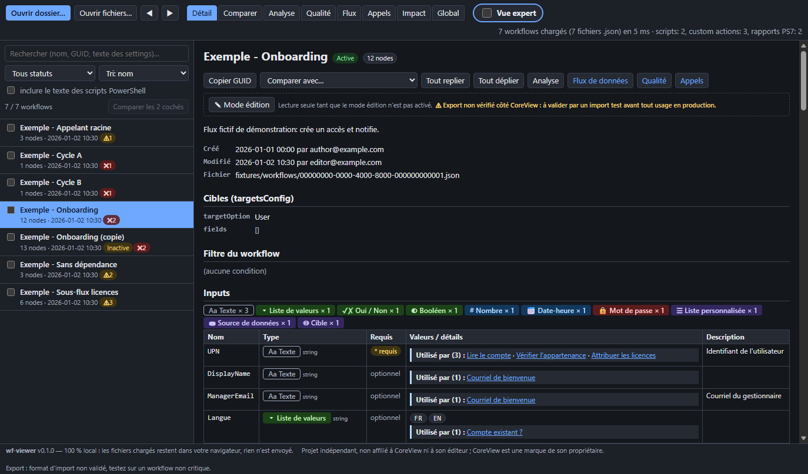
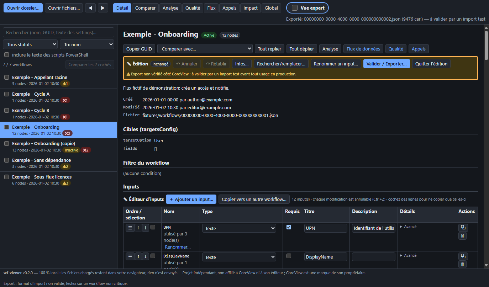

# wf-viewer

[Français](README.md) · **English**

**A local viewer for workflows exported as JSON**: browse, compare, analyze, debug, read the associated PowerShell scripts and, with care, edit and re-export. A 100% static page (HTML + JavaScript), with no server and no dependency.

> **Independent project, not affiliated with CoreView or its publisher.** CoreView is a trademark of its owner. This tool is neither endorsed nor supported by them.

Version 0.4.0 — bilingual interface (French / English).





*(The screenshots come from the fictional sample data, which is written in French.)*

## Privacy

- **100% local**: the files you load stay in your browser; nothing is sent anywhere. The code contains no network request (no `fetch`, no CDN, no external font or script).
- The page declares a strict security policy (`Content-Security-Policy`: `default-src 'none'`, `connect-src 'none'`, scripts and styles `'self'` only) and `referrer: no-referrer`.
- Any content coming from your files (including email HTML or script text) is displayed as **text**: it is never interpreted as HTML.
- Only display preferences are stored in the browser (`localStorage`: expert view, language, linter rules, highlighting).

## Interface language (French / English)

- **The default language is the browser's**: if the first preferred language (`navigator.languages[0]`) starts with `fr`, the interface is in **French**; in every other case it is in **English**.
- **Manual switch**: a **Language** selector (Français / English) in the top bar, next to “Expert view”. The change is immediate, **without reloading**: the selected workflow, the tab, the comparison, the expert view, the filters, the loaded workflows and any edits in progress (with their undo/redo history) are all kept.
- **Priority**: the `lang=fr|en` URL parameter (`#wf=…&tab=…&lang=en`, shareable) > the choice remembered in this browser (`localStorage`, key `wfv.lang`) > the browser language.
- **Values coming from your files** (names, descriptions, settings, scripts, identifiers) are never translated. The demo data stays fictional and in French; only the demo banner and the guided tour are translated.
- The English translations are still being proofread: feel free to point out wording that could be improved.

## Features

| Area | What it does |
|---|---|
| **Viewing** | Workflow list (search, status filter, sort), detail: name, status, targets, typed inputs (text, list, yes/no, boolean, number, date, password, custom list, data source, target), node tree (sequences, conditions, TRUE/FALSE branches), readable conditions, `{{…}}` references as clickable pills, nested workflow calls. |
| **Navigation** | Keyboard (↑/↓ in the list, Alt+←/→ for history), shareable links through the URL (`#wf=…&tab=…`). |
| **Comparison** | Diff of two workflows: nodes aligned by type and name (not by identifier), settings compared field by field, normalized references, hideable technical noise, typed inputs diff, before/after summaries of the actions. |
| **Analysis** | Token variables and functions, broken references, nodes whose output is never used, global usage views. |
| **Quality** | Linter with switchable rules (malformed token, suspect output path, reference to a missing or later-defined node, unused or undeclared input, empty sequence, `if` without a branch, cyclic nested call, PS7 status, mandatory script parameter not provided…). The messages talk about *suspect* items: this is not an official validation. |
| **Data flow** | SVG graph of the dependencies between nodes and from the inputs (zoom, pan, upstream/downstream highlighting). |
| **Calls** | Call graph between workflows, caller/callee trees, cycles, roots, orphans, consistency with `parentWorkflowIds`. |
| **Impact** | For a custom action, a variable or a function: affected workflows and nodes, transitive impact through nested calls, Markdown export. |
| **PowerShell scripts** | Script panel per custom action with syntax highlighting (in-house tokenizer, offline), arguments passed vs `param()`, search in the script text, status of the PS7 compatibility report. |
| **Editing and export** | Explicit edit mode per workflow: name/description/status, setting value, structured find/replace with preview, replacing a function or a node type, renaming an input everywhere, delete/duplicate/move a node, undo/redo. An unmodified workflow is re-exported **byte-for-byte identical**. |
| **Input editing** | Tabular editor built into the Inputs section (edit mode, basic and expert views): add, delete, duplicate, reorder (buttons or drag and drop), rename with propagation to `{{input::…}}` references (preview of the number of references and warnings), edit title / description / required / tooltip / default value, change the **type** by category (text, list of values, Yes/No, boolean, integer, date-time, password, target, data source, custom list) while keeping unknown keys and reporting lost data, list values editor (add, delete, order, multi-line paste, de-duplication, sort, search; more than 1000 values without blocking), password rules, suggestions of already-seen sources/lists, copying inputs to another workflow (skip / rename / overwrite). Raw input JSON in expert view. Everything goes through the editing engine (undo/redo, validation, faithful export). Schema shapes come from the structure of the observed exports; those marked “partly inferred” (Yes/No, password rules) are flagged in the interface. |
| **Basic / expert view** | “Expert view” checkbox (`E` key): the basic view hides identifiers, raw JSON and technical schemas; the expert view shows everything. The state is kept and shareable (`x=1` in the URL). |

## Try it without files: demo data

The **Load demo data** button (welcome screen and top bar) loads **entirely fictional** workflows, PowerShell scripts, custom actions and a PS7 report, as if you had picked them yourself (same checks, same indexes, faithful export). The data is embedded in `src/demo-data.js` (no network request, CSP unchanged). A “Demo data (fictional)” banner stays visible with **Guided tour** (list, detail, comparison of a duplicate, Quality, expert view, editing and the input editor; ←/→ to navigate, Esc to close) and **Exit demo**. If your own files are already loaded, the tool asks whether to **replace** or **add**; the examples carry a “demo” badge. Exporting an example remains possible (it is flagged “fictional example”).

## Usage

1. Open `index.html` (double-click, `file://`) or the page published on GitHub Pages.
2. Click **Open folder…** (or drag and drop a folder / files) and choose a folder containing your exported workflows (`*.json`, one workflow per file, `{"data":{…}}` envelope).
3. Optional — enrich the display of custom actions by loading, in the same folder or separately: the `*.ps1` scripts named after the custom action GUID, the `customaction*.raw.txt` lists (one or several pages) and the compatibility reports `*.csv` (columns `File`, `Status`…). Files are recognized by their name.
4. Navigate with the list, the tabs (Detail, Compare, Analysis, Quality, Flow, Calls, Impact, Global) and the links.

A fully fictional sample set is provided in [`fixtures/`](fixtures/): load that folder to try the tool.

### Browsers

- **Tested: Microsoft Edge** (automated headless browser test, including the English interface).
- **Chrome and Edge** (recent versions) are recommended (native folder picker; File System Access for the optional export).
- Other browsers should work through the “folder” fallback (`webkitdirectory`) and drag and drop, but **Firefox and Safari have not been tested**.

## ⚠ Export warning

The export produces a JSON file in the same style as the original, but **the import format expected by CoreView has not been validated**. Test the import on a non-critical workflow and **keep your originals**. The original files are never modified by the application: the export is a download (or a save you choose). Volatile fields (`updatedAt`, `updatedDate`) are only changed if you tick the option.

## Known limitations

- Designed from the structure of observed exports; other versions of the format may show partial information. Unreadable workflows are listed as errors without blocking the rest.
- The linter rules, the descriptions of native actions marked “inferred from name” and the interpretation of `parentWorkflowIds` (list of callers) are unconfirmed heuristics.
- PowerShell highlighting is lexical (no full syntax analysis).
- Nested sequences are not handled by editing.
- Very large graphs are limited to 50 displayed nodes; the interface is not optimized for thousands of workflows.
- Several tabs/windows in parallel are not handled (unexported changes are lost on close).
- The English translations have not been reviewed by a native speaker yet.

## Repository structure

```
index.html            single page (strict CSP, footer, version)
src/                  “classic” JavaScript modules (UMD) + style.css
  version.js          single version constant
  i18n.js i18n-fr.js i18n-en.js   internationalization (t(), plurals, language detection, embedded dictionaries)
  demo-data.js        demo data generated from fixtures/ (npm run build:demo); demo-logic.js demo-ui.js
  model.js refs.js diff.js analysis.js inputs.js natives.js labels.js   model, references, diff, analysis
  scripts.js pshighlight.js                                             PowerShell scripts, highlighting
  graph.js lint.js edit.js                                              graphs, linter, editing/export
  ui.js edit-ui.js inputs-ui.js insight-ui.js loader.js                 interface (DOM, textContent only)
fixtures/             FICTIONAL data set (workflows, scripts, custom actions, PS7 CSV)
tools/gen-fixtures.js generates fixtures/ (invented values)
tests/                node tests (including tests/i18n.test.js) + browser test
docs/                 screenshots generated from the fixtures
```

Technical choice: classic scripts (`<script src>`) rather than ES modules, because browsers block modules on `file://`.

## Development and tests

Node ≥ 22, no dependency to install.

```sh
npm test                          # unit tests (fictional ./fixtures set)
npm run smoke                     # browser test (local Chrome/Edge, headless, via CDP)
WFV_SERVE=1 npm run smoke         # same through a small local HTTP server (127.0.0.1)
WFV_DATA=/path/to/my/data npm test   # tests on another folder (expected counts are those of the fixtures)
npm run fixtures                  # regenerates fixtures/
npm run build:demo                # regenerates src/demo-data.js from fixtures/ (a test checks that it is up to date)
```

The browser test detects Edge/Chrome or takes a path as an argument (`node tests/browser-smoke.js /path/to/chrome`, or `WFV_BROWSER`); it skips cleanly if it finds none. It fails on any console error, exception or CSP violation.

## Publishing (GitHub Pages)

The `.github/workflows/ci.yml` workflow runs the tests and then deploys only `index.html`, `src/` and `docs/` (never `tests/` or `fixtures/`). Enable Pages with the **GitHub Actions** source.

## License

[MIT](LICENSE) — © 2026 Francois Harvey.
