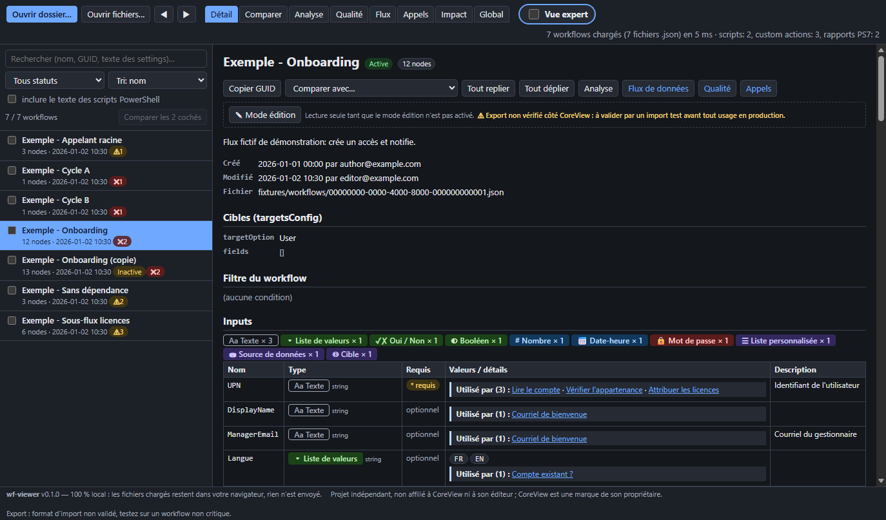
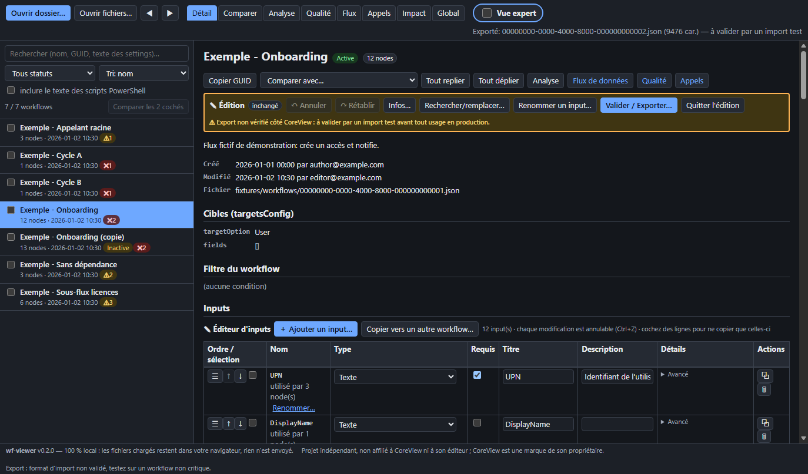

# wf-viewer

**Visionneuse locale de workflows exportés en JSON** : naviguer, comparer, analyser, déboguer, lire les scripts PowerShell associés et, avec prudence, éditer et réexporter. Page 100 % statique (HTML + JavaScript), sans serveur ni dépendance.

> **Projet indépendant, non affilié à CoreView ni à son éditeur.** CoreView est une marque de son propriétaire. Cet outil n'est ni approuvé ni supporté par lui.

*English summary: a single-page, offline, dependency-free viewer for exported workflow JSON files (browse, diff, lint, data-flow / call graphs, impact reports, PowerShell script viewer with syntax highlighting, guarded editing and export). Everything runs locally in your browser; nothing is uploaded. Not affiliated with CoreView. Exports are NOT validated against any import format: test on a non-critical workflow and keep your originals. MIT licensed.*





## Confidentialité

- **100 % local** : les fichiers que vous chargez restent dans votre navigateur ; rien n'est envoyé nulle part. Le code ne contient aucune requête réseau (pas de `fetch`, pas de CDN, pas de police ni de script externe).
- La page déclare une politique de sécurité stricte (`Content-Security-Policy` : `default-src 'none'`, `connect-src 'none'`, scripts et styles `'self'` uniquement) et `referrer: no-referrer`.
- Tout contenu issu de vos fichiers (y compris le HTML des courriels ou le texte des scripts) est affiché comme **texte** : il n'est jamais interprété comme HTML.
- Seules des préférences d'affichage sont mémorisées dans le navigateur (`localStorage` : vue expert, règles du linter, coloration).

## Fonctionnalités

| Domaine | Ce que ça fait |
|---|---|
| **Visualisation** | Liste de workflows (recherche, filtre de statut, tri), détail : nom, statut, cibles, inputs typés (texte, liste, oui/non, booléen, nombre, date, mot de passe, liste personnalisée, source de données, cible), arbre des nodes (séquences, conditions, branches vrai/faux), conditions lisibles, références `{{…}}` en pastilles cliquables, appels de workflows imbriqués. |
| **Navigation** | Clavier (↑/↓ dans la liste, Alt+←/→ pour l'historique), liens partageables via l'URL (`#wf=…&tab=…`). |
| **Comparaison** | Diff de deux workflows : nodes alignés par type et nom (pas par identifiant), settings comparés champ par champ, références normalisées, bruit technique masquable, diff typé des inputs, résumés avant/après des actions. |
| **Analyse** | Variables et fonctions de tokens, références cassées, nodes dont la sortie n'est jamais utilisée, vues globales d'usage. |
| **Qualité** | Linter à règles activables (token mal formé, chemin de sortie suspect, référence vers un node absent ou défini plus tard, input inutilisé ou non déclaré, séquence vide, `if` sans branche, appel imbriqué cyclique, statut PS7, paramètre obligatoire de script non fourni…). Les messages parlent d'éléments *suspects* : ce n'est pas une validation officielle. |
| **Flux de données** | Graphe SVG des dépendances entre nodes et depuis les inputs (zoom, déplacement, surbrillance amont/aval). |
| **Appels** | Graphe des appels entre workflows, arbres d'appelants/appelés, cycles, racines, orphelins, cohérence avec `parentWorkflowIds`. |
| **Impact** | Pour une custom action, une variable ou une fonction : workflows et nodes concernés, impact transitif via les appels imbriqués, export Markdown. |
| **Scripts PowerShell** | Panneau de script par custom action avec coloration syntaxique (tokenizer maison, hors-ligne), arguments passés vs `param()`, recherche dans le texte des scripts, statut du rapport de compatibilité PS7. |
| **Édition et export** | Mode édition explicite par workflow : nom/description/statut, valeur de setting, rechercher/remplacer structuré avec aperçu, remplacement de fonction ou de type d'action, renommage d'un input partout, supprimer/dupliquer/déplacer un node, annuler/rétablir. Un workflow non modifié se réexporte **identique octet pour octet**. |
| **Édition des inputs** | Éditeur tabulaire intégré à la section Inputs (mode édition, vues de base et expert) : ajouter, supprimer, dupliquer, réordonner (boutons ou glisser-déposer), renommer avec propagation aux références `{{input::…}}` (aperçu du nombre de références et avertissements), éditer titre / description / requis / infobulle / valeur par défaut, changer le **type** par catégorie (texte, liste de valeurs, Oui/Non, booléen, nombre entier, date-heure, mot de passe, cible, source de données, liste personnalisée) en conservant les clés inconnues et en signalant les données perdues, éditeur de valeurs de liste (ajout, suppression, ordre, collage multi-lignes, dédoublonnage, tri, recherche; plus de 1000 valeurs sans blocage), règles de mot de passe, suggestions de sources/listes déjà vues, copie d'inputs vers un autre workflow (ignorer / renommer / écraser). JSON brut de l'input en vue expert. Tout passe par le moteur d'édition (annuler/rétablir, validation, export fidèle). Les formes de schéma proviennent de la structure des exports observés ; celles marquées « partiellement déduites » (Oui/Non, règles de mot de passe) sont signalées dans l'interface. |
| **Vue de base / expert** | Case « Vue expert » (touche `E`) : la vue de base masque identifiants, JSON bruts et schémas techniques ; la vue expert montre tout. État conservé et partageable (`x=1` dans l'URL). |

## Essayer sans fichier : données de démonstration

Bouton **Charger les données démo** (écran d'accueil et barre du haut) : charge des workflows, scripts PowerShell, custom actions et un rapport PS7 **entièrement fictifs**, comme si vous les aviez choisis vous-même (mêmes contrôles, mêmes index, export fidèle). Les données sont embarquées dans `src/demo-data.js` (aucune requête réseau, CSP inchangée). Un bandeau « Données de démonstration (fictives) » reste affiché avec **Visite guidée** (liste, détail, comparaison d'un duplicata, Qualité, vue expert, édition et éditeur d'inputs ; navigation ←/→, Échap pour fermer) et **Quitter la démo**. Si vos propres fichiers sont déjà chargés, l'outil demande de **remplacer** ou d'**ajouter** ; les exemples portent un badge « démo ». L'export d'un exemple reste possible (il est signalé « exemple fictif »).

## Utilisation

1. Ouvrez `index.html` (double-clic, `file://`) ou la page publiée sur GitHub Pages.
2. Cliquez **Ouvrir dossier…** (ou glissez-déposez un dossier / des fichiers) et choisissez un dossier contenant vos workflows exportés (`*.json`, un workflow par fichier, enveloppe `{"data":{…}}`).
3. Optionnel — enrichir l'affichage des custom actions en chargeant, dans le même dossier ou séparément : les scripts `*.ps1` nommés par GUID de custom action, les listes `customaction*.raw.txt` (une ou plusieurs pages) et les rapports de compatibilité `*.csv` (colonnes `File`, `Status`…). Les fichiers sont reconnus par leur nom.
4. Naviguez avec la liste, les onglets (Détail, Comparer, Analyse, Qualité, Flux, Appels, Impact, Global) et les liens.

Un jeu d'exemple entièrement fictif est fourni dans [`fixtures/`](fixtures/) : chargez ce dossier pour essayer l'outil.

### Navigateurs

- **Chrome et Edge** (récents) : recommandés (sélecteur de dossier natif ; File System Access pour l'export optionnel).
- Les autres navigateurs devraient fonctionner via le repli « dossier » (`webkitdirectory`) et le glisser-déposer, mais **Firefox et Safari n'ont pas été testés**.

## ⚠ Avertissement sur l'export

L'export produit un fichier JSON dans le même style que l'original, mais **le format d'import attendu par CoreView n'a pas été validé**. Testez l'import sur un workflow non critique et **gardez vos originaux**. Les fichiers d'origine ne sont jamais modifiés par l'application : l'export est un téléchargement (ou un enregistrement choisi par vous). Les champs volatils (`updatedAt`, `updatedDate`) ne sont modifiés que si vous cochez l'option.

## Limites connues

- Conçu d'après la structure d'exports observée ; d'autres versions du format peuvent afficher des informations partielles. Les workflows illisibles sont listés en erreur sans bloquer le reste.
- Les règles du linter, les descriptions françaises des actions natives marquées « déduit du nom » et l'interprétation de `parentWorkflowIds` (liste des appelants) sont des heuristiques non confirmées.
- La coloration PowerShell est lexicale (pas d'analyse syntaxique complète).
- Les séquences imbriquées ne sont pas gérées par l'édition.
- Les très gros graphes sont limités à 50 nodes affichés ; l'interface n'est pas optimisée pour des milliers de workflows.
- Pas de gestion de plusieurs onglets/fenêtres en parallèle (les modifications non exportées sont perdues à la fermeture).

## Structure du dépôt

```
index.html            page unique (CSP stricte, pied de page, version)
src/                  modules JavaScript « classiques » (UMD) + style.css
  version.js          constante de version unique
  demo-data.js        données de démo générées depuis fixtures/ (npm run build:demo) ; demo-logic.js demo-ui.js
  model.js refs.js diff.js analysis.js inputs.js natives.js labels.js   modèle, références, diff, analyse
  scripts.js pshighlight.js                                             scripts PowerShell, coloration
  graph.js lint.js edit.js                                              graphes, linter, édition/export
  ui.js edit-ui.js inputs-ui.js insight-ui.js loader.js                 interface (DOM, textContent uniquement)
fixtures/             jeu de données FICTIF (workflows, scripts, custom actions, CSV PS7)
tools/gen-fixtures.js génère fixtures/ (valeurs inventées)
tests/                tests node + test navigateur
docs/                 captures générées depuis les fixtures
```

Choix technique : scripts classiques (`<script src>`) plutôt que modules ES, car les navigateurs bloquent les modules en `file://`.

## Développement et tests

Node ≥ 22, aucune dépendance à installer.

```sh
npm test                          # tests unitaires (jeu fictif ./fixtures)
npm run smoke                     # test navigateur (Chrome/Edge local, headless, via CDP)
WFV_SERVE=1 npm run smoke         # idem via un petit serveur HTTP local (127.0.0.1)
WFV_DATA=/chemin/vers/mes/donnees npm test   # tests sur un autre dossier (les comptes attendus sont ceux des fixtures)
npm run fixtures                  # régénère fixtures/
npm run build:demo                # régénère src/demo-data.js depuis fixtures/ (un test vérifie qu'il est à jour)
```

Le test navigateur détecte Edge/Chrome ou prend un chemin en argument (`node tests/browser-smoke.js /chemin/chrome`, ou `WFV_BROWSER`) ; il s'ignore proprement s'il n'en trouve pas. Il échoue sur toute erreur console, exception ou violation de la politique CSP.

## Publication (GitHub Pages)

Le workflow `.github/workflows/ci.yml` lance les tests puis déploie uniquement `index.html`, `src/` et `docs/` (jamais `tests/` ni `fixtures/`). Activez Pages avec la source **GitHub Actions**.

## Licence

[MIT](LICENSE) — © 2026 Francois Harvey.
